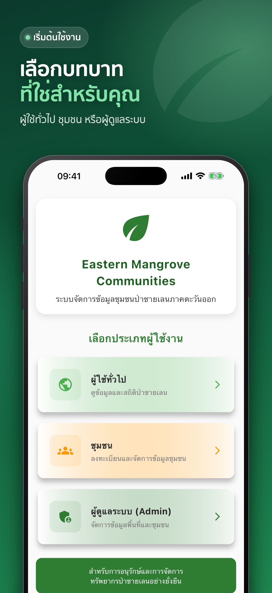
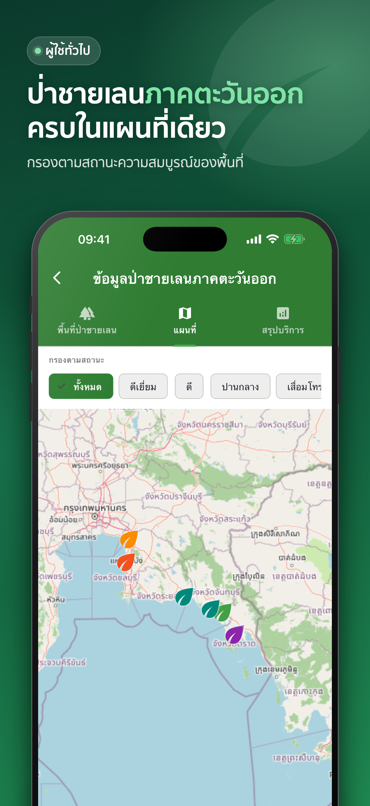
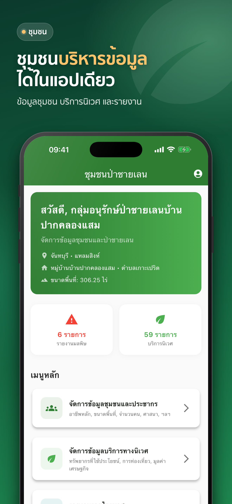
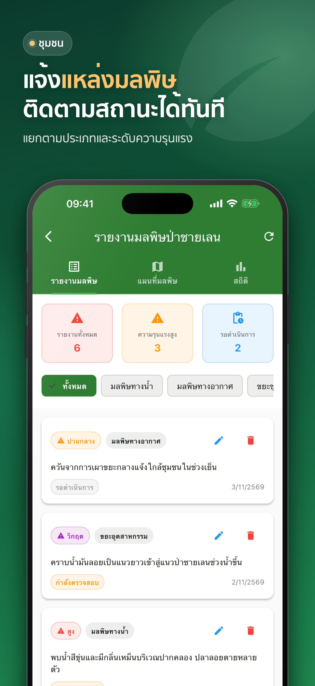
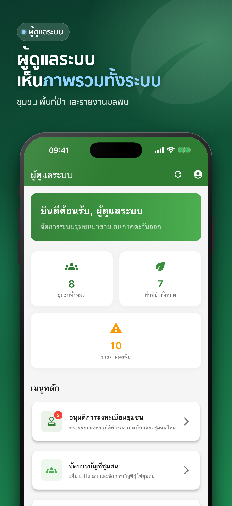

<div align="center">


# Eastern Mangrove Communities

**ระบบจัดการข้อมูลชุมชนป่าชายเลนภาคตะวันออก**

A mobile platform that lets mangrove communities in eastern Thailand report their
data, log pollution incidents, and gives administrators and the public a live
picture of mangrove conservation across the region.


</div>

<p align="center">
  
  
  
  
  
</p>

> The screenshots use fictional demo data.

## Overview

Mangrove forests protect Thailand's eastern coast, but information about the
communities that look after them is scattered across paper forms and
spreadsheets. This app brings it into one place with three kinds of users:

| Role | What they can do |
|---|---|
| **Public** | Browse mangrove areas on a map and see region-wide statistics, no sign-in needed |
| **Community** | Register a community, maintain its profile, record ecosystem services and income, file quarterly reports, and report pollution with a map location |
| **Admin** | Approve or reject community registrations, manage mangrove areas and accounts, and monitor the whole system from a dashboard |

Built end to end as a solo project: product scope, Flutter app, REST API,
database design, deployment and App Store release.

## Features

- **Community registration with approval workflow**: communities sign up in two
  steps, an admin reviews the request, and only approved accounts can sign in.
- **Mangrove area management**: areas with location, size, species and
  conservation status, shown on an interactive map (OpenStreetMap via
  `flutter_map`).
- **Pollution reporting**: type, severity, status, source, *expected impact on
  the mangrove* and a map-picked location, plus list, map and statistics views.
- **Ecosystem services and economic data**: resource use, tourism and income,
  summarised in quarterly reports.
- **Public statistics**: number of areas, communities, total area and
  pollution reports.
- **Thai-first UX**: Thai UI, Buddhist Era (พ.ศ.) dates and areas in rai.
- **Privacy-minded**: location permission is requested only when the map is
  opened.

## Architecture

```
┌──────────────────────┐   HTTPS / JSON   ┌───────────────────────────┐        ┌──────────────┐
│  Flutter app (iOS,   │ ───────────────► │  Node.js + Express API    │ ─────► │ PostgreSQL   │
│  Android)            │ ◄─────────────── │  JWT auth, role-based     │ ◄───── │ (11 tables)  │
│  Provider, Dio       │                  │  routes: public/community │        └──────────────┘
└──────────────────────┘                  │  /admin  · hosted on Render│
                                          └───────────────────────────┘
```

| Layer | Technology |
|---|---|
| Mobile app | Flutter / Dart, Provider, Dio, `flutter_map`, `geolocator`, `image_picker` |
| API | Node.js, Express, JWT, bcrypt, Joi validation, Helmet, rate limiting |
| Database | PostgreSQL (dedicated schema) |
| Hosting | Render (API and database), App Store distribution |

### Repository layout

```
eastern_mangrove_app/   Flutter app (lib/screens: public, community, admin, auth)
api-server/             Express API (routes/public, routes/community, routes/admin)
database/               Schema migrations and a fictional demo dataset
docs/                   Store assets and screenshots
RELEASE_NOTES_*.md      Per-version release notes (Thai and English)
```

## Engineering notes

A few problems that were more interesting than the feature list suggests:

- **Unit consistency.** The database stores area in hectares, while Thai users
  think in rai (1 ha = 6.25 rai). Conversion lives in one place in the API
  client, and the release shipped with an idempotent SQL migration that only
  touches rows still holding their original value, so it is safe to re-run.
- **Calendar consistency.** Dates are stored as Gregorian and displayed as
  Buddhist Era through a single `ThaiDate` utility.
- **Safe releases.** Each release has written notes, a rollback path for data
  migrations and an ordering (migrate, deploy API, release the app) so older
  app versions keep working.
- **Layered API protection.** Role-based JWT middleware, schema validation on
  every write, rate limiting and secure headers.
- **Reproducible demo data.** A seed script builds a fictional dataset and
  refuses to run unless the target is a local `*demo*` database. An API smoke
  test exercises the main CRUD flows.

## Getting started

### Prerequisites

Flutter 3.x (Dart ≥ 3.8), Node.js 18+, PostgreSQL 14+.

### 1. Database and demo data

The schema is in [`schema_structure`](schema_structure) with incremental
changes in `database/migration_*.sql`. For local development use the fictional
demo dataset; [`database/demo/README.md`](database/demo/README.md) has the full
workflow (create the demo database, seed it, demo logins, smoke test).

### 2. API

```bash
cd api-server
npm install
cp .env.example .env        # then fill in the database settings and JWT secret
DB_NAME=eastern_mangrove_demo PORT=3002 npm start
```

### 3. App

```bash
cd eastern_mangrove_app
flutter pub get
flutter run --dart-define=API_BASE_URL=http://127.0.0.1:3002/api
```

Without `API_BASE_URL` the app talks to the production API.

## Releases

Version history with changelogs (Thai and English) is in the
`RELEASE_NOTES_v*.md` files. Current version: **1.0.12 (build 12)**.

## Author

**Krittapat Seangsomjai** · [GitHub @krittapat1998](https://github.com/krittapat1998)
